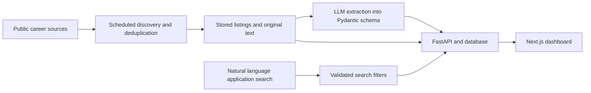

# Career Tracker

A personal application for discovering AI and data roles, extracting job requirements and tracking applications across European markets.

**Project type:** personal software project  
**Stack:** Python, FastAPI, Pydantic, SQLAlchemy, Next.js, TypeScript, OpenAI, Anthropic, PostgreSQL, Microsoft Graph, GitHub Actions  
**Availability:** public case study; source code remains private.

## Problem

Job discovery and application tracking involve different records: a vacancy may be worth reviewing without an application having been submitted. I built a dashboard that keeps these stages separate and connects discovery, structured job information and follow-up activity.

## What I built

- A scheduled discovery pipeline for public career and applicant-tracking-system sources, with filtering and deduplication before persistence.
- Structured extraction of company, role, location, seniority, requirements and optional salary information using an LLM and Pydantic schemas.
- A natural-language search flow that translates a request into validated application filters, including keywords, region, status and dates.
- A FastAPI backend and Next.js interface for listings and applications, with Microsoft Graph integration for Outlook mail and calendar workflows.
- Explicit extraction states and retry handling so incomplete AI processing can be revisited.

## Architecture

OpenAI is used for the current extraction and discovery flows; Anthropic is used for natural-language application search. Local development supports SQLite, with PostgreSQL configured for the deployed backend.

## Engineering decisions

**Keep the original evidence.** Original posting text is retained alongside extracted fields. A structured response is easier to use, but schema validation alone does not establish that every extracted fact is correct.

**Make AI failure recoverable.** The application preserves the posting when AI processing is unavailable and supports simpler fallback extraction, processing states and retries.

**Separate search intent from database execution.** The model produces a defined filter object instead of arbitrary SQL. The backend applies the supported filters.

**Automate repeatable collection.** GitHub Actions runs the discovery workflow, records reports and controls overlapping runs.

## Verification and limitations

The repository contains automated tests for listing extraction, sources, APIs, application workflows and security-related behavior. This case study does not claim a current passing-test count or measured extraction accuracy.

This is a personal application. Public-source coverage, changing posting formats and missing salary or location information remain practical limitations. There is no production benchmark here for relevance, latency or cost.

## Example workflow

An illustrative search such as “applications in the Netherlands awaiting a reply” becomes supported application filters. Separately, discovered jobs can be reviewed before being added to the application pipeline. This example describes intended interaction and contains no real application data.

## Next improvements

- Build a manually labeled set of job postings to measure field-level extraction accuracy and missing-field behavior.
- Track source freshness, duplicate rates and failures over time.
- Measure latency and provider usage on representative workloads.

[Back to portfolio](../README.md)
