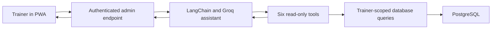

# Personal Trainer LLM

A training-management application with an administrative AI assistant for answering questions about clients, bookings, credits and recorded activity.

**Project name:** Umberto PT Pro  
**Project type:** personal software project  
**Stack:** Python, FastAPI, PostgreSQL, LangChain, Groq, JavaScript PWA, Docker, GitHub Actions  
**Availability:** public case study; source code remains private. No public live demo is linked.

## Problem

A trainer needs to retrieve information spread across client records, bookings, payments and training plans. I built an application that combines these workflows and adds an assistant with defined read-only tools.

## What I built

- A progressive web application for bookings, lesson credits, training records and administrative workflows.
- A FastAPI backend with PostgreSQL, authentication, Google Calendar integration and email reminders.
- A LangChain/Groq assistant with six tools for client lists, client details, dashboard summaries, performance analytics, payments and training plans.
- Trainer-scoped data access in tool handlers, administrative access to the assistant and a bounded tool-call loop.
- A separate offline evaluation harness using synthetic records.

## Architecture

The assistant retrieves application data through defined tools. Its tools read records; they do not create bookings, change payments or modify training plans.

## Engineering decisions

**Constrain the assistant's actions.** Tool dispatch uses a defined set of functions, with a maximum of five agent iterations and endpoint rate limiting.

**Scope data access.** Tool handlers receive the authenticated trainer context and apply trainer-specific queries.

**Reduce email exposure.** Email addresses are masked in tool responses. This is a limited measure: names and other relevant record fields can still be provided to the model, so it should not be described as full anonymization.

**Separate demo data from integrations.** The project supports a synthetic demonstration mode without Google integration. The AI feature is configurable and disabled by default in the documented production setup pending configuration.

## Evaluation work

The repository includes an offline harness with synthetic questions, expected tools, reference answers, safety cases, bootstrap intervals and paired comparisons.

The current saved baseline evaluates a deterministic synthetic agent. Its default judge checks expected keywords. It does **not** establish the real LangChain/Groq assistant's answer quality, safety, latency or cost. Accordingly, I do not present the synthetic report's success percentages as production performance.

The application's displayed confidence and token values are heuristic estimates. They are not calibrated probabilities or provider billing measurements.

## What this project demonstrates

Integration of an LLM into an existing application, explicit tool boundaries, authenticated data retrieval and the design of a reproducible evaluation workflow.

## Next improvements

- Run a separate evaluation of the actual assistant on synthetic records, including ambiguous requests and incorrect tool selections.
- Review answers manually against reference data.
- Measure end-to-end latency and provider usage.
- Expand checks for authorization boundaries and unnecessary personal-data exposure.

[Back to portfolio](../README.md)
